# Architecture & System Design Visualizations

This document provides architectural diagrams for Porta di Ferro, illustrating component boundaries, state lifecycles, event synchronization, tournament ranking pipelines, and offline-first capabilities.

---

## Shared Pure Functions (`internal/hall`)

Before diving into deployment and state machines, here's the core logic shared by HTTP handlers and the demo:

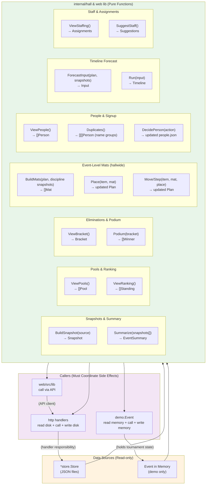

**Key Principle:** Logic that decides outcomes lives as pure functions in `hall`. Handlers read the disk, call hall functions, and write the result. The demo calls the same functions over in-memory state. This prevents double implementations and keeps domain logic independent of I/O.

---

## 1. System & Deployment Architecture

Porta di Ferro runs as a single Go binary on the organizer's PC, embedding the Svelte 5 SPA via `//go:embed`. Devices connect locally across the venue LAN without requiring an external internet connection. One run is one event: every discipline in one process, at one address, each with its own data folder (§1a).

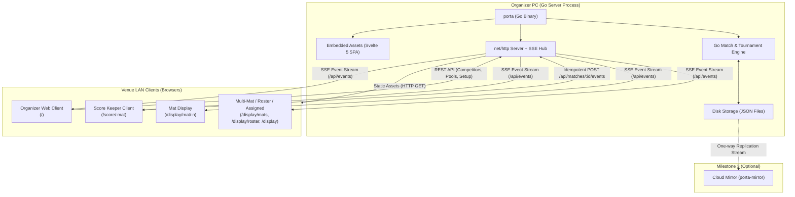

---

### 1a. One event, many disciplines — Component & Data Flow Architecture

One run of `porta` is one **event**: every discipline of the day in one process, at one address, each in a folder of its own (issue #102, [docs/proposals/one-event-many-disciplines.md](proposals/one-event-many-disciplines.md), phase 1). Each discipline is an `httpapi.Server` exactly as it was when it was a process of its own — its own `store.Store`, lock, SSE hub and presence — mounted by `httpapi.Coordinator` under `/api/d/{slug}/`. The coordinator owns what is about the event: `event.json` (the welcome, the wifi, the signup settings, the plan and the order of the disciplines), the event's stream, and the address everything is served from.

**Component & Data Flow:**

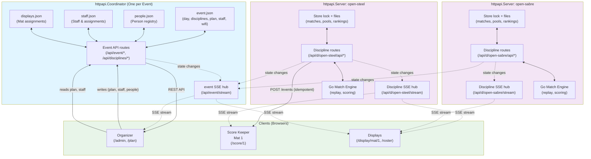

**Key Rules:**
- **Event is authoritative**: Only `Coordinator` writes `event.json`, `people.json`, `staff.json`, `displays.json`.
- **Disciplines are independent**: Each has its own store lock, files, and SSE hub.
- **Discipline servers read the event**: They fetch `event.json` to get the day's metadata but never write it directly.
- **Score keeper pushes to discipline server**: `POST /api/d/{slug}/matches/{id}/events` with idempotent `(match_id, seq)`.
- **All clients listen to event SSE**: For event-level changes (plan, staff, discipline list).
- **Discipline SSE is per-discipline**: For match-level updates within that discipline.

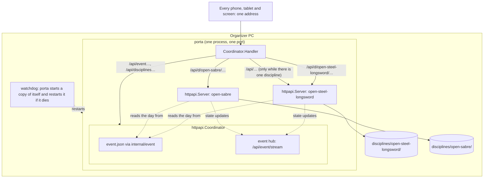

- **A new event has no disciplines** (#149). A first start, and a deleted event, are an empty folder: `/admin` is a welcome with two ways in, a guided tour (`web/src/lib/tour.svelte.ts`) and Plan the event, and the disciplines are added while planning it. The last discipline can be taken out too.
- **A discipline's identifier can change** (#153). `PUT /api/disciplines/{d}/identifier` renames its folder and carries what the event keeps about it (`store.Plan.MoveDiscipline`, `store.Staff.MoveDiscipline`, `event.Folder.MoveTo`). The old identifier stays in `event.File.Aliases`, so a link, an unsent exchange or a response to a signup file already sent (`signup.Definition.Moved`) still reaches the discipline; nobody else can take it, and the discipline can go back to it. The signup panel asks first once the day has come.
- **Addresses.** A discipline's API is `/api/d/{slug}/…` and its pages `/d/{slug}/…` (`/d/{slug}/admin` or `/admin/{slug}` for its admin, `/d/{slug}/setup` for its setup). `/admin` is always the event's admin page. While the event has one discipline, the unprefixed paths answer as it, so a one-discipline event is exactly what a run of the application always was; with several, or none, they answer 409, and the client's unprefixed pages ask which one. The slug comes from the name and never changes, except once for a discipline made before it had a name, whose old slug stays as an alias.
- **The day is the event's.** A discipline's snapshot carries `event.json` laid over its own tournament, which keeps none of it. A discipline's `PUT /api/d/{slug}/event` writes the day to the event, so every admin screen saves as it always did.
- **A broken discipline is contained.** Each discipline's files are read when it loads; one that does not parse is listed with the reason, served as 503, shown on the landing page from its last summary, and reloaded with `POST /api/disciplines/{slug}/reload` once fixed. A broken `event.json` blanks the day and nothing else.
- **The event's stream** carries `hall.Summarize` of every discipline — stage, progress, what is on each mat, the podium, the entrants — coalesced over 150 ms, so the event landing page holds one stream however many disciplines there are.
- **One stream per page** (#161). A browser gives one address six HTTP/1.1 connections, so a page follows everything over `GET /api/streams?topic=event&topic=mats&topic=d/{slug}` (`d/` for the event's only discipline): each frame is a hub's update tagged with its `topic`, and the stream ends when any hub drops it, so EventSource reopens it. In the client, `lib/streams.ts` keeps that one connection for every `EventLive`, `MatsLive` and `Live` on the page, and lets it go after 15 seconds hidden; coming back, each follower asks for a fresh picture. The single streams (`/api/event/stream`, `/api/mats/stream`, `/api/d/{slug}/stream`) still answer.
- **Clients keep disciplines apart.** IndexedDB is keyed `[discipline, match, seq]`, and an unsent exchange is pushed to the discipline it was scored in whatever page is open; the snapshot cache and the score keeper's remembered state are namespaced per discipline (`web/src/lib/paths.ts`).
- **Opening an old folder** moves its files into `disciplines/<slug>/` and lifts its day into `event.json` (`internal/event/migrate.go`); the move resumes if interrupted.
- **Deleting the event** (`DELETE /api/event`, #141) lets every discipline go, moves everything in the folder under `deleted/<time>-<name>/`, and starts an empty event in its place, with no disciplines, as a first start does. Every event has an identity (`id` in `event.json`, carried on `GET /api/event` and `GET /api/mats`); a device that sees a different one from the one it last saw clears its match logs and cached views before using the new one (`web/src/lib/forget.ts`), because the new event's `open-sabre/p1m1` has the same key as the old one's.

### Event-wide mats (phase 2)

The mats are the event's. Each discipline's work is **work items** — each pool, its eliminations on each of its lanes, the bronze match, the final (`hall.ItemsOf`) — and the plan in `event.json` places each item on one of the hall's mats, at a place in that mat's queue (`store.Plan`). The discipline still decides what its items are and how the matches inside each are ordered; the plan decides which mat runs each and when.

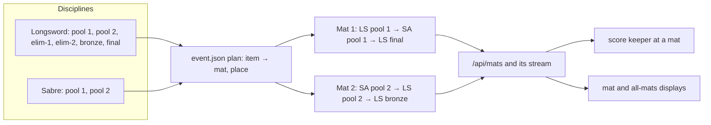

- **Placing.** A new item — pools just drawn, a bracket just drawn, a redraw (the item's `Stamp` changes) — goes to the end of the mat its lane maps to (`hall.Place`). With one discipline and no mat count set, the event has that discipline's mats and every item lands where it always ran, so a one-discipline event is unchanged.
- **What a mat runs** (`hall.BuildMats`): the match its live score keeper is holding, or else the first match still to fence in the first item on its queue that is not done. A mat waits rather than skipping ahead when that item's next match is still waiting on a feeder.
- **Where a mat stops** (`hall.ShouldAdvanceToDiscipline`, the field test of 2026-11). A mat never crosses into another discipline by itself: when the next item is another discipline's than the one it ran last, the item's status is `held` and the mat's `held`/`heldFor` name it, until the organizer presses *Start* on the mat board. The organizer can also stop a mat in front of any item from its card (`PATCH /api/plan/items/{id}` with `{"hold": true}`; `false` releases it). Both are kept on the item's placement (`hold`, `released`). An item under way is never stopped. The score keeper's *Next match* never goes past a held item, or one waiting for its block (`runnable` in `lib/mats.svelte.ts`), offline included, and says what the mat is waiting for.
- **Moving** (`PATCH /api/plan/items/{discipline}/{key}`, `hall.Move`/`Step`): an item under way or done cannot move, and nothing can be put in front of it, so a mat never changes what it runs in the middle of an item. A discipline's own pool controls move its items the same way. `PUT /api/mats` sets how many mats the hall has; a mat running something cannot be taken away.
- **Snapshots speak event mats** (`hall.OnEventMats`): every pool and bracket match in a discipline's snapshot says the mat the plan runs it on, so standings, rosters, pool sheets and personal pages need no change; `eventMats` says how many there are.
- **Who owns the mat count.** The hall's count (`hall.MatCount`: `plan.mats` in `event.json` when the organizer set it, otherwise the largest discipline's) is the authority. A discipline's own `tournament.mats` is the organizer's choice for that discipline, kept as typed, and never more than the hall can give: `hall.EffectiveMatCount` caps it, and `hall.OnHall` is the tournament every draw (pools and bracket), the plan and the forecast work from. The snapshot's `usableMats` is that capped number, and the eliminations' mat choice offers it. Taking a mat away (`PUT /api/mats`) therefore takes it from every discipline at once, and giving it back returns it; nothing raises the hall's count on its own.
- **Void matches** (#162). A pool match with a withdrawn competitor is `void` in the snapshot (`MatchView.Settled`): the mat, the pool's `complete`, the forecast and the progress counts all pass over it, as the ranking already did, while it stays listed with any result it had. Reinstating the competitor brings it back.
- **Go / no-go** (#167). `GET /api/disciplines/{d}/gonogo` (and `GET /api/gonogo` for all) is `hall.GoNoGo`: what could go wrong with a discipline -- staff slots unfilled, a forecast past the venue's close, fewer mats than its numbers recommend -- and the tournament manager's sign-off, `POST` with `{"by": "Kim"}`, kept in `plan.signoffs` with the facts it was given on (mats, block, day, start, pool sizes, elimination mats). When one of those changes the sign-off is no longer `current`, and `changed` says which. It warns and never refuses: the discipline admin page shows it, the mat board names the disciplines without a current go, and nothing waits for one.
- **A global timeout** (#157). `PUT /api/event/halt` (`{"on": true, "reason": "..."}`, from the mat board) stops the whole hall while the physician is busy: `event.json` keeps `halt`, and `GET /api/mats` and its stream carry it. Every score keeper pauses a running clock and will not start one or confirm an exchange, and every screen says so, until the organizer ends it.
- **Devices are the event's.** Heartbeats, screen assignments (`displays.json` in the event folder) and the Screens panel are event-level, and one registry is shared by every discipline, so a claim on a match anywhere asks it whether the holder is alive. A score keeper registers its mat, match and the match's discipline, and the client keys everything it keeps by discipline and match id, because ids repeat across disciplines.
- **The mat board** (`MatBoard.svelte`) shows every mat's queue as cards and moves them by a pointer-events drag or by each card's menu.

### People and the event's signup (phase 3)

A person is one human across the event. `people.json` in the event folder holds one record per person with a random id (`pr-` and twelve hex digits, so ids never collide the way per-discipline competitor ids do), and each competitor entry points at one (`Competitor.Person`). The rules are pure functions in `internal/people`; the coordinator applies them to the files and `demo.Event` to memory.

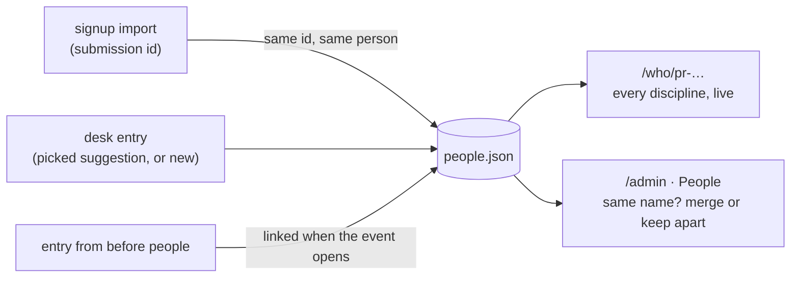

- **Who an entry is** (`people.For`): the person the desk picked, else whoever came in on the same signup submission, else somebody new. A name is never enough on its own: two Anna Nilssons from one club are real, and "Karl-Johan" and "Karl Johan" are one person, so people with the same folded name are offered on the event admin's People panel (`people.Duplicates`) to merge, or to keep apart so they stop being offered.
- **A merge can be undone.** The merged person keeps `mergedInto` and the entries it moved, so `unmerge` puts exactly those back. An id merged away still resolves (`people.Resolve`), so a link somebody shared keeps working.
- **Locks.** The registry has its own lock and is never held while a discipline's is wanted, because a discipline's signup import holds its own lock and asks the registry for a person. Changes are decided under the registry's lock and written to the entries after, through `Server.LinkPeople`.
- **Endpoints.** `GET /api/people` (everybody with an entry, and the duplicate groups), `GET /api/people/{id}`, and `POST /api/people/{id}/{merge|unmerge|apart|link}`.
- **One signup for the event.** `/api/event/signup/…` serves the event's definition and app, and previews and imports a folder across every discipline. The definition offers the disciplines themselves, by slug and name, with each one's capacity and planned start (`Coordinator.SignupDefinition`, #142); the programme goes out alongside, to read. Each discipline takes its share through the same `signup.Check` it runs on its own, as its own slug, and the preview says per response which disciplines it goes into. A discipline's own `/api/d/{slug}/signup/…` answers with the event's definition.
- **An email is a person.** Every response carries one; it is kept on the person in `people.json` (never in a view), so a second response with the same address, from any device, is the same person (`people.For`, `people.ByEmail`): `already` where they are entered, a new entry of the same person where they are not, and never asked about as a possible duplicate of somebody with another address.
- **The person's page** (`Person.svelte`) fetches the person and stacks one live `PersonEntry` per discipline. The old `/who/c7` loads the discipline, and moves on to `/who/{person}` once it knows who that is.

### The plan's times (phase 4)

Three timelines, kept apart: the **plan** (where each item runs, the organizer's), the **actual** (the match logs) and the **forecast** (the plan re-timed from the actual). `internal/forecast` is pure; `hall.ForecastInput` builds its input from the disciplines' snapshots and the plan, and the coordinator and `demo.Event` both call it.

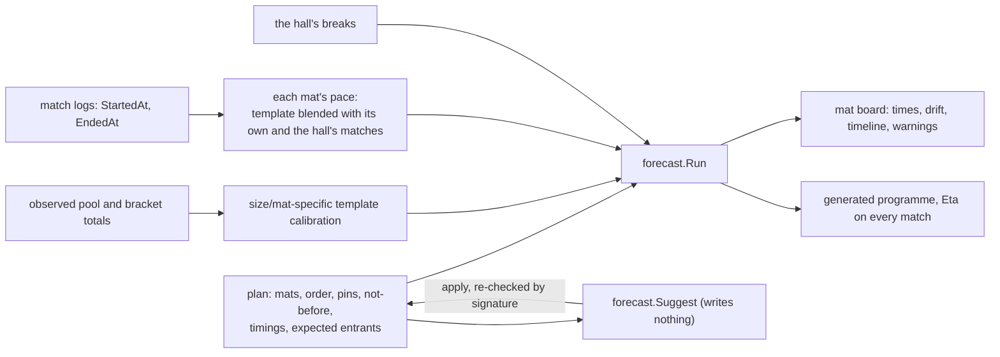

- **Timings** (`store.Timings` in the plan): a match, the changeover, the pause before a discipline's eliminations, the day's start and the venue's close. Zero fields fall back to `porta-timings.json` beside the event folder, the organizer's template for new events, and then to the built-in one. The measured day (`GET /api/plan/report`) can be written back into them (`POST /api/plan/timings/learn`) and kept for new events (`POST /api/plan/timings/default`), leaving out matches marked as anomalies.
- **Typical durations** calibrate the built-in four-minute match and one-minute changeover, for drawn and projected work alike. Organizer-supplied pool totals are 40/50/70/95 minutes for 4/5/6/7 people (6/10/15/21 matches). Bracket totals include bronze and final: eight qualifiers take 45/40 minutes on 1/2 elimination mats; sixteen take 85/55/50/45 minutes on 1/2/3/4 mats; thirty-two take 160/80/65/55 minutes. Pool totals are distributed over their matches; a bracket's match and changeover template is scaled against its dependency-aware, uninterrupted simulation. Breaks, holds, the pause after pools and held finals still add their own time; allowing bronze beside the final still saves time. Live hall and mat measurements gradually replace the calibrated template with the same prior weights as the generic pace, excluding anomalies. Custom match/changeover settings and unlisted sizes or mat counts retain generic timing. The draw currently caps qualification at eight; the forecast also covers larger bracket-shaped inputs without changing that draw rule.
- **The plan's day** (#149): the hall's breaks (`PUT /api/plan/breaks`; lunch when unnamed) stop every mat; each discipline's gear check and staff briefing (`PUT /api/plan/prep`, in seconds; a quarter of an hour each until told otherwise, #153) come before its first pool, the gear check ending 15 minutes ahead of it and the briefing 30, or ahead of a longer gear check, and are not timed against the mats; and a discipline's earliest start (`PUT /api/plan/starts`) holds all of its work. An event planned before the plan held breaks reads the break rows of its old typed programme instead.
- **The programme is generated, never typed** (#149): `hall.ViewForecast` lists each discipline's gear check, staff briefing, pools, eliminations and final, and the breaks, in the order of the day. The landing pages, the info sheet and its PDF (`hall.ProgrammeSchedule`) and the signup's planned starts all read it. The forecast view's `gaps` point out a day with no break and a discipline with no gear check or briefing; nothing is refused.
- **Projected work**: a discipline with entrants, or the number it expects (`PUT /api/plan/expected`), and no draw yet has the items `tournament.Generate` and `tournament.Bracket` would give it over stand-in entrants (`hall.ProjectedItems`). They are planned cards on the board, after all real work; a mat never waits on one; a place the organizer gave one (a move, a hold, an applied suggestion) is the drawn item's.
- **The forecast** simulates each mat match by match: logged matches where the logs put them, the rest at the mat's pace, around programme breaks, after what each item waits for (eliminations after the discipline's pools plus the pause, the final after the eliminations and after the bronze match -- unless the bronze is let run with it, a flag on its card, #149), not before an item's hold time, and once the day is live never before now. The same run on the template from the day's start is the planned day, drawn as a ghost. It warns of a person in two items at once, an item placed before what it waits for, and a day ending after the venue closes.
- **More than one day** (#122). `plan.days` gives a block of the day a date (`PUT /api/plan/days`, `{"2": "2026-11-22"}`). Its work, holds and discipline starts are times of that date, and no earlier than the day's start; the hall's breaks and the mats' times away repeat on every day; the nights between days are closed to every mat (`forecast.Input.Closed`) and kept out of the programme, which heads each day's rows with its date. Before anything is fenced the forecast starts on the first dated day; undated blocks run on the first day.
- **How many mats** (#153). A discipline's setup does not ask. The forecast view's `mats` says what each discipline's numbers recommend (`tournament.RecommendedMats`: one per pool at its largest pool size, up to four, from what it expects or else its ceiling, and never fewer than have entered), and `matsRecommended` what the busiest block of the day comes to for the hall. A discipline takes the recommendation when its setup is first finished, and Planning the day chooses from there.
- **The mat board has the day on it** (#153): the cards stand at their forecast times, with a strip of hours between the mats and on the outsides, and the hall's breaks across every mat. A card too short for its text pushes the next one down rather than hiding anything, and a mat with moves in the draft shows its movable cards one after another.
- **Only pools move by hand** (#149). `hall.Move` refuses an elimination, bronze match or final, which follow the pools wherever the plan puts them, and a pool dropped behind its own discipline's bracket on a mat lands in front of it. A pool held to a later start pushes what follows on its mat only as far as they would overlap.
- **Suggestions** (`POST /api/plan/suggest`) are greedy list scheduling: what is under way stays, pinned items keep their mat and their order among the other pins on it (#121), the rest go in priority order to the mat where each can start soonest. The order never depends on the current plan, so suggesting again after applying moves nothing. `POST /api/plan/apply` works it out again and refuses a stale signature.
- A suggestion's reported finish and move start times come from re-running the shared match-by-match forecast over its proposed placements, so calibration and feeder waits match the applied plan.
- **Where the hall sees it**: `GET /api/forecast` for the board and the planning panel; the event view's `programme`, which both landing pages and the info sheet list; and `Eta` on every pending match in a discipline's snapshot (filled through `EventMats.Hall`), which a person's page shows as "about 10:40". Times go out in the server's zone and are printed as written.

### Staff (phase 5)

Staff belong to the event (#5): one person cannot referee two mats at once, and must never be put on a mat while fencing. `staff.json` in the event folder holds the members -- each linked to a person of the event, with the roles they offered and the disciplines they will work -- the crew a mat needs, and the assignments. `internal/staffing` is pure; the coordinator and `demo.Event` both call it.

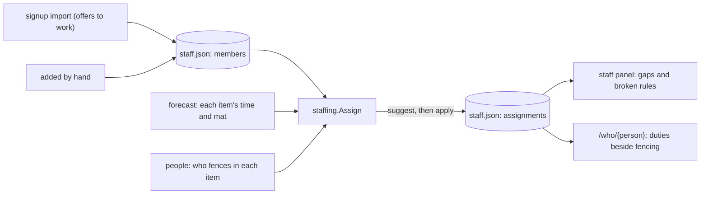

- **Members.** A signup response offering to work is one member however many disciplines it offers; the same submission as a competitor entry is the same person, which is how their fencing is known. The organizer adds members by hand, picking the competitor they are when the desk suggests one. Each discipline's own staff list -- what every run kept in its tournament before -- is lifted into `staff.json` the first time the event opens, and a discipline's pages still list and remove its members (`EventStaff`).
- **Assigning** (`staffing.Assign`) walks the items in the order the forecast runs them and fills each mat's crew (by default two referees -- a head referee and an assistant -- and a score keeper, until the ruleset says otherwise; `PUT /api/staff/crew`), the scarcest role first. Never anyone fencing at the time or on another mat, and never anyone competing in another discipline at the time, even in a hole in their own schedule (#153): `hall.StillIn` is who is still in each discipline, every entry until its bracket is drawn and then whoever has a match to come, and they are ruled out from the discipline's first item to its last, a final held to the end of the day counting only for those named in it. In their own discipline a fencer may still referee a pool they are not in; only roles offered, in disciplines they work. Among those who may: whoever held this role on this mat just before, then this role anywhere, then this mat, else whoever has worked least; and past two and a half hours without a pause, anybody else free first. A physician is on call for the hall, not on a mat: the board's timeline draws them as a bar across the whole day, orange when nobody is. `StaffingView.needed` is the fewest people who could staff the plan, a crew on every mat at the busiest moment.
- **The organizer's choices stand.** A slot chosen by hand (`PUT /api/staff/assignments`) is pinned, and the crew of an item under way is kept. `staffing.Check` reports every empty slot and every kept assignment that breaks a rule; nothing is refused. `POST /api/staff/suggest` writes nothing; `POST /api/staff/apply` works it out again and refuses a stale signature.
- **Where it is seen.** The staff panel on the event admin lists members with the pools they are the crew of, the crew, and every item of the plan with a picker per slot. A pool's crew stays with it from the first match to the last. `GET /api/people/{person}` carries `duties` and `physician`, which a person's page lists beside their fencing; somebody who only works has a page too.

### 1b. The public demo

The same client with no server under it (issue #88, [docs/demo.md](docs/demo.md)). Deployed to GitHub Pages from `main`; the production deployment above is unchanged.

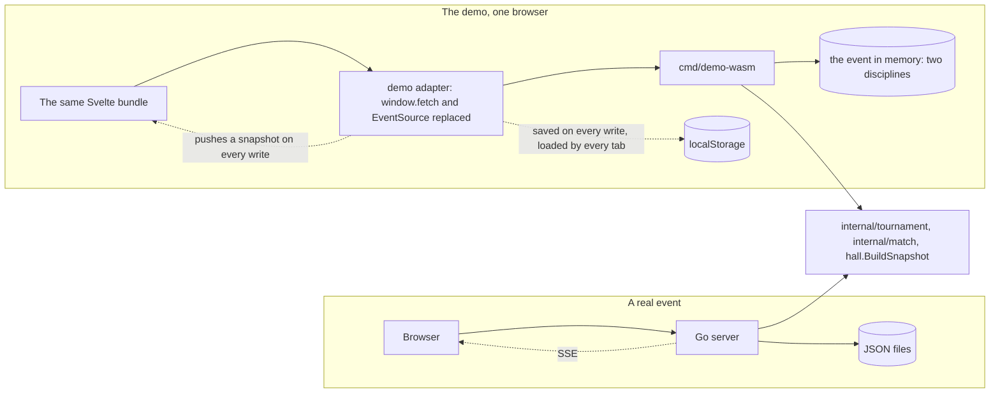

`BuildSnapshot` takes a `Source` — the four reads a snapshot needs — so `*store.Store` serves it off disk for an event and the demo serves it out of memory. `demo.Event` is the demo's coordinator: it answers the event's paths and hands `/api/d/{slug}/…` to each `demo.Demo`, the same way `httpapi.Coordinator` does. Both sides reach the same tournament code, which is what stops the demo drifting into a second, subtly different implementation of the standings.

Each tab runs its own copy of the module. The adapter saves the whole tournament to `localStorage` after every write, each new tab loads it, and open tabs follow the `storage` event, so the tabs of one browser share one tournament the way the tablets and the PC share one at an event (issue #108). A visitor away for half an hour comes back to the fixture.

### 1c. The three views

Who each screen is for (issue #98). The address on the poster by the door reaches every phone in the hall, so what it lands on can change nothing.

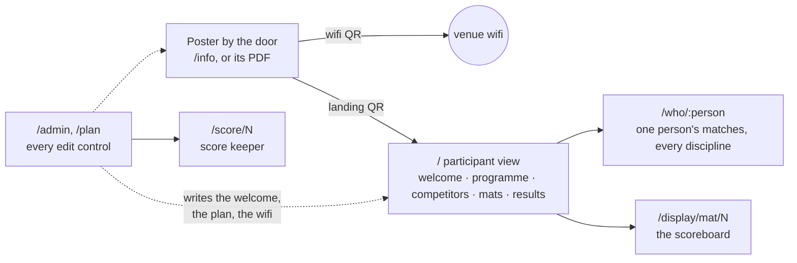

| Route | For | Writes anything? |
| --- | --- | --- |
| `/` | competitors and spectators | no |
| `/who/:person` | the same, one person at a time, across the event (`/who/c7` moves on to its person) | no |
| `/info` | the wall by the entrance, on screen or printed | no |
| `/admin`, `/plan` | the organizer | everything, from the organizer's PC only (#165) |

The server takes the organizer's writes from loopback alone, and refuses cross-site writes and foreign `Host` names before any handler runs (`internal/http/guard.go`; `docs/design.md`, "Who may change what"). A score keeper's exchanges and claims and every device's heartbeat are the hall's, and open to it.

`Tournament.Event` — the welcome message, the event's name, venue and date, and the venue wifi — is written only from Plan the event and read by the other two; the programme beside it is generated from the plan (#149). None of it reaches a result.

### 1d. Offline Signup Workflow

Registration without an internet-facing server (issue #91, [docs/proposals/offline-signup.md](proposals/offline-signup.md)). Two files and no network between them.

**Detailed Workflow:**

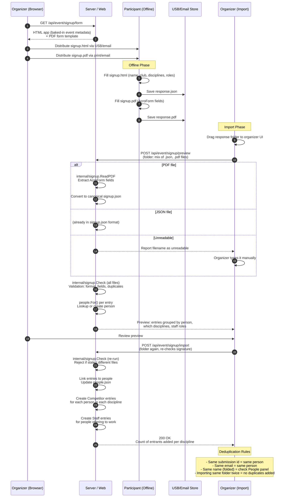

**Offline Signup Features:**

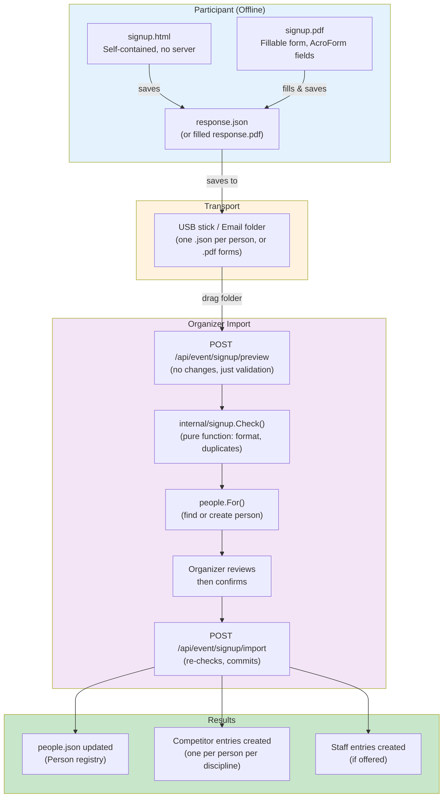

**Key Properties:**
- **Idempotent submission ID**: Same folder imported twice doesn't add duplicates.
- **Email as identity**: Same email = same person across disciplines and devices.
- **Pure validation**: `internal/signup.Check()` decides everything before writing.
- **PDF support**: AcroForm fields extracted locally (lazy-load pdf-lib), converted to canonical JSON.
- **Staff integration**: Offers to work create staff entries, linked to person (prevents double-booking).
- **People deduplication**: Duplicates by folded name offered on /admin · People panel (merge/keep apart).

## 2. Match Engine State Machine & Scoring Logic

Matches are driven by an append-only event log. State is pure and recomputed by replaying events. The one exception to append-only is the organizer's editor (`PUT /api/matches/{id}/events`), which rewrites a log wholesale and keeps the previous version as `matches/<id>.ndjson.<timestamp>.bak`; a `log-replaced` SSE update tells a score keeper holding the match to reload it. Event types are `exchange`, `timer` (start / stop / resume / reset), `undo`, `end`, and `options` — the last carries the competitors' colours and the display side order, is ignored by replay, and is read separately by `OptionsOf` / `optionsOf` so presentation can never fail a scoring vector. Points are differential (e.g., scoring $2$ vs $1$ awards $1$ net point to the higher scorer), capped at $8$ points or $3$ minutes ($180\,000\text{ ms}$).

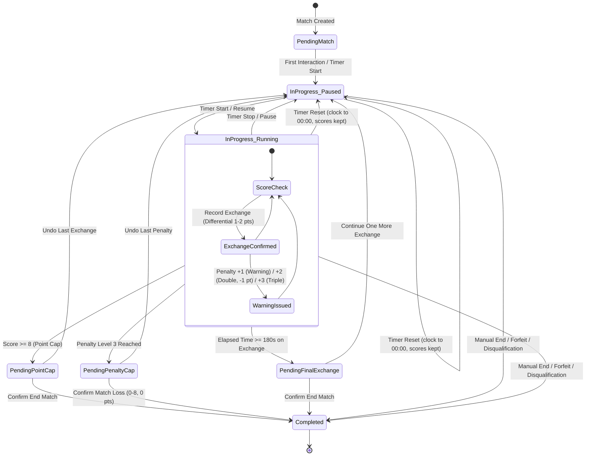

---

## 3. Data Flow, Sync & Event Logging

The score keeper client applies updates optimistically to its local TypeScript engine while queueing the event to IndexedDB. The event is posted with `(match_id, sequence)` for server validation, JSON disk persistence, and SSE broadcast.

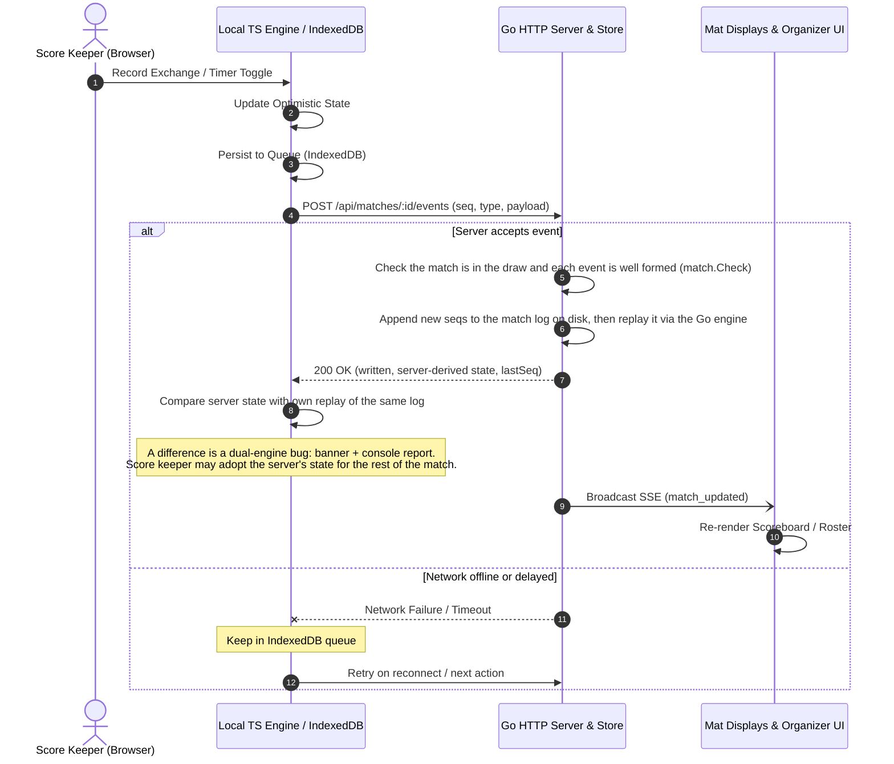

---

## 3b. Connected Clients, Handover and Server-Assigned Displays

Every score keeper client and every `/display` screen announces itself with a stable id and heartbeats every five seconds (`POST /api/clients/{id}`); the registry lives in memory and is pushed to the organizer over SSE as `presence`. A score keeper claims its match before writing (`POST /api/matches/{id}/claim`) and stamps every push with the granted epoch; the claims live in `writers.json` so they survive a restart. A match held by another device is never handed on without the new device asking: the claim is refused with who holds it and whether it is alive or has gone quiet, and the score keeper takes it over by saying so (#150). The holder asks `GET /api/matches/{id}/claim` every five seconds while it has nothing to send, so a device that has been taken over locks its scoring before its next exchange rather than having it set aside. A push with no epoch is refused while a device holds the match. The mat's own idea of which match is up follows the live score keeper on it, so displays show a finished match's result for exactly as long as the score keeper holds it.

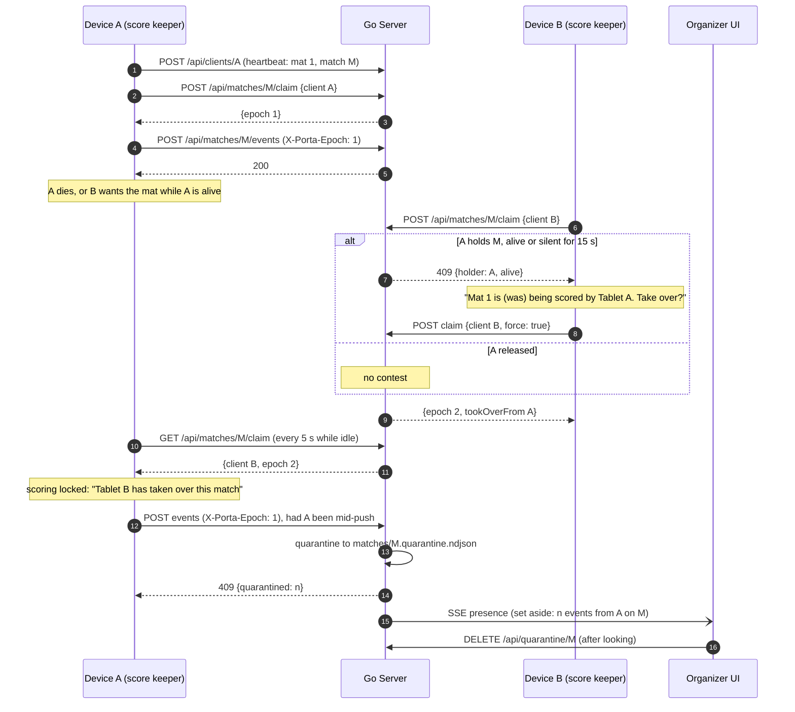

**A replaced draw is set aside the same way** (#160). Match ids are positional -- `p1m1` is in every draw -- so every match in the snapshot carries `draw` (the pools' `generatedAt` or the bracket's `bracketAt`, `hall.DrawOf`). The score keeper stores it with each event in IndexedDB and sends it as `X-Porta-Draw` on every push. A push from a draw that has been replaced is quarantined and answered `409 {redrawn: true}`, and the device then drops that draw's events; it never merges them into the new pairing's log.

Displays: a screen opens `/display`, heartbeats with role `display`, and renders whatever `target` comes back (`mat/1`, `mats`, `mats/1,2`, `roster`; an old `audience/2` shows mat 2's scoreboard). The organizer sets it with `PUT /api/clients/{id}/target`; assignments are kept in `displays.json`.

---

## 4. Tournament Lifecycle & Ranking Pipeline

Tournaments progress through competitor intake, pool generation, schedule assignment across mats, match execution, and multi-tier index ranking.

**Tournament Stages & State Transitions:**

```mermaid
flowchart TD
    Start["(1) Register & Setup<br/>Add competitors, configure mats/mat count"] 
    Start --> DrawPools["(2) Draw Pools<br/>Generate pools: sizes balanced, clubs spread"]
    
    DrawPools --> PoolsNotes["(2.5) Pool Generation Details<br/>- Redraw retires old logs as .bak (match ids are positional)<br/>- Organizer can override pool order with Pool.Sequence<br/>- Snapshot serves pools in run order"]
    PoolsNotes --> PoolsRun["(3) Run Pools<br/>Matches executed on mats, logged to disk"]
    
    PoolsRun --> CompetitorWithdrawn{Competitor<br/>withdrawn?}
    CompetitorWithdrawn -->|Yes| VoidMatches["(3.5) Void Withdrawn Competitor<br/>All their matches removed, others replayed"]
    CompetitorWithdrawn -->|No| KeepResults["(3.5) Keep Results<br/>All match logs stand"]
    
    VoidMatches --> RankPool["(4) Rank Within Pools<br/>Apply tie-break chain on each pool"]
    KeepResults --> RankPool
    
    RankPool --> RankDetails["(4.5) Ranking Tie-Break Chain:<br/>① MPI (Match Points / Matches)<br/>② VI (Wins / Matches)<br/>③ SI (Points Scored / Matches)<br/>④ RI (Points Conceded / Matches, lower wins)<br/>⑤ H2H (Head-to-Head comparison)<br/>⑥ Deterministic draw (FNV seed)"]
    RankDetails --> PoolsComplete["(5) Pool Results Stand<br/>Final Standing per pool"]
    
    PoolsComplete --> DrawBracket["(6) Draw Eliminations<br/>Overall ranking, top 8 qualifies<br/>Seeding: 1v8, 2v7, 3v6, 4v5"]
    
    DrawBracket --> ElimMatsDecision{Organizer set<br/>ElimMats?}
    ElimMatsDecision -->|No| CalcMinMats["Compute min mats:<br/>fewest mats that complete<br/>bracket in as many passes as full set"]
    ElimMatsDecision -->|Yes| UseMats["Use organizer's ElimMats count"]
    CalcMinMats --> AssignElim["Spread bracket across mats"]
    UseMats --> AssignElim
    
    AssignElim --> RunBracket["(7) Run Bracket Matches<br/>Quarters → Semis → Bronze & Final<br/>Later rounds filled from results"]
    
    RunBracket --> FinalResults["(8) Final Results<br/>Podium (Gold, Silver, Bronze)"]
    
    style Start fill:#bbdefb
    style DrawPools fill:#bbdefb
    style PoolsRun fill:#fff9c4
    style RankPool fill:#c8e6c9
    style DrawBracket fill:#bbdefb
    style RunBracket fill:#fff9c4
    style FinalResults fill:#c8e6c9
```

Drawing the pools again is a restart rather than a relabelling. Match ids are positional — pool 1's first match is `p1m1` in every draw — so the logs of the draw being replaced are retired to dated `.bak` files first, the bracket with them. Without that, a redrawn pool keeps the previous pool's results under the new competitors' names (issue #93).

```mermaid
flowchart TD
    A[Add / Register Competitors] --> B[Generate Pools: sizes within one, clubs spread by a greedy deal plus a swap pass, remainder reported]
    B --> B2[Redraw retires the logs of the draw it replaces as dated .bak files, bracket included: match ids are positional and would otherwise be inherited]
    B2 --> C[Generate Schedule & Assign Mats]
    C --> C2{Organizer override?}
    C2 -- Move / reorder pool --> C3[Pool.Sequence updated; snapshot serves pools in run order]
    C2 -- No --> D
    C3 --> D[Execute Matches at Mats]
    D --> E{Competitor Withdrawn?}

    E -- Yes --> F[Void All Matches for Withdrawn Competitor]
    E -- No --> G[Keep Match Results]
    F --> H[Replay Match Log for Active Competitors]
    G --> H

    H --> I[Calculate Standing Metrics per Pool]

    subgraph RankingChain["Tie-break Chain (Order of Application)"]
        I --> J1["1. Match Point Index (MPI = Match Points / Matches)"]
        J1 --> J2["2. Victory Index (VI = Wins / Matches)"]
        J2 --> J3["3. Score Index (SI = Points Scored / Matches)"]
        J3 --> J4["4. Reception Index (RI = Points Conceded / Matches, lowest wins)"]
        J4 --> J5["5. Head-to-Head Comparison"]
        J5 --> J6["6. Deterministic Random Draw (FNV Seed)"]
    end

    J6 --> K[Final Pool Standings]
    K --> L{Every pool match in?}
    L -- Yes --> M[Overall ranking across pools by the same chain]
    M --> M2{Mats for the eliminations}
    M2 -- Organizer set ElimMats --> N
    M2 -- Unset --> M3[Fewest mats that finish the bracket in as many passes as the full set: 2 of 3, 4 of 4]
    M3 --> N[Bracket: top 8, 1v8 4v5 / 2v7 3v6, bronze and final, spread over those mats]
    N --> O[Later rounds filled from results on every snapshot; sudden death on the client when level at the final exchange]
    O --> P[Podium]
```

---

## 5. Offline & Local-First Resilience

Scorekeeper devices stay operational even during transient venue Wi-Fi dropouts through IndexedDB event spooling. The last snapshot is kept in `localStorage` too, so a client opens with the pool's schedule and names when the server is unreachable; the score keeper client keeps its own record of which matches it has finished, so it can move through a whole pool offline. On reconnect, every match log on the device that the server is missing is pushed — not only the match on screen.

**A tablet cannot reload offline.** A service worker registers only on a secure origin, and every device but the organizer's PC reaches the server at `http://<LAN address>` (`docs/tech-stack.md` §6, `AGENTS.md`). So the service worker's app shell serves the organizer's browser on `localhost` alone; a tablet keeps working through a dropout because its page is already loaded, and a reload while the LAN is down fails until it is back (#166).

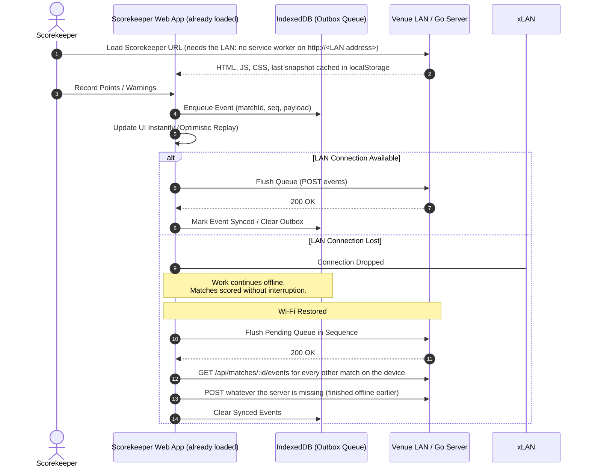
